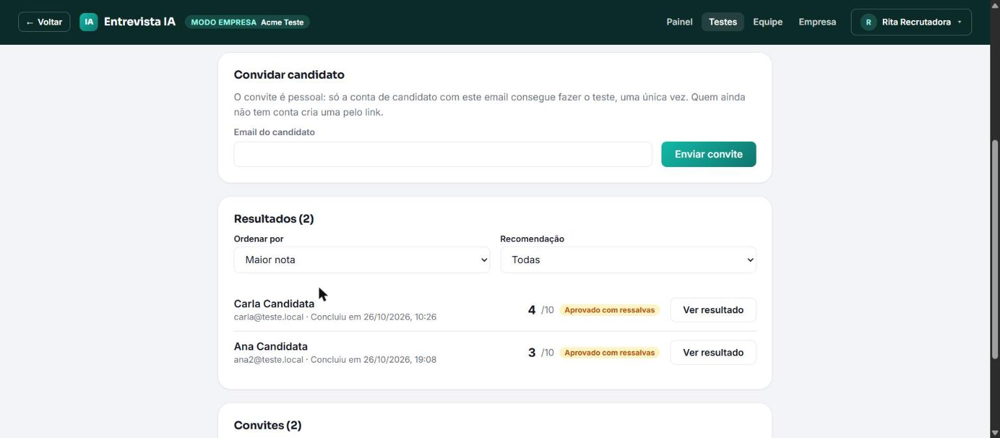
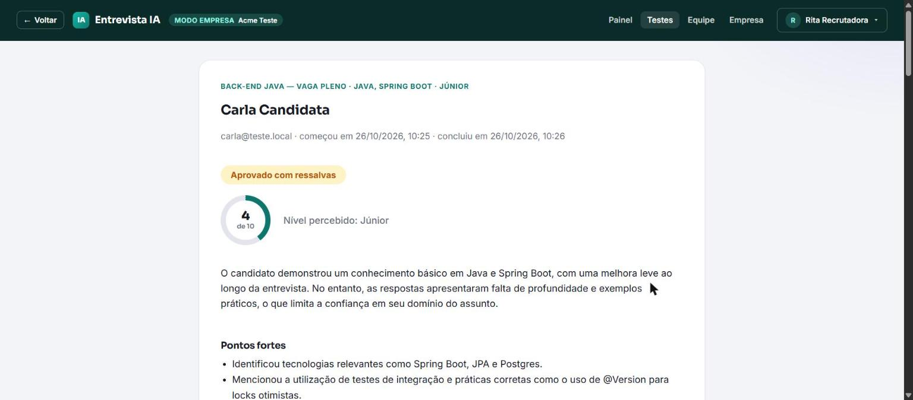

# Simulador de Entrevista Técnica com IA

[](https://github.com/guilhermepg23/EntrevistaAi/actions/workflows/ci.yml)
&nbsp;·&nbsp; **Demo:** https://entrevista-ai-five.vercel.app

Projeto de portfólio: simulador de entrevistas técnicas adaptativo, usando IA para gerar
perguntas, avaliar respostas e produzir um relatório final.

Desde a v1.1 há dois tipos de conta. O **candidato** treina entrevistas e faz os testes
para os quais foi convidado. O **recrutador** trabalha em nome de uma empresa: monta testes,
convida candidatos e vê os resultados (ver [Modo empresa](#modo-empresa-v11)).

> **Cold start**: o backend roda no free tier do Render e hiberna após 15 min. A primeira
> requisição depois disso leva ~1 min (o app mostra um aviso). Abra a demo um pouco antes.

## Estrutura

- `backend/` — Spring Boot (Java), API REST + integração com OpenAI
- `frontend/` — React + TypeScript, interface tipo chat

## Telas

Modo empresa: resultados de um teste e o resultado completo de um candidato. Mais
capturas em [`docs/`](docs/).




## Status atual

### Backend — funcional, testado ponta a ponta

- Modelagem de entidades JPA (User, Interview, Question, Answer, FeedbackReport,
  ResumeAnalysis)
- Autenticação JWT completa (register/login, filtro, security config, CORS)
- **Cadastro com CPF**: `@Cpf` (Bean Validation) valida formato + dígitos verificadores +
  rejeita sequências repetidas; coluna `cpf` única no `User`, normalizada pra só dígitos,
  com checagem de duplicidade no registro (`AUTH_CPF_TAKEN`)
- **Recuperação de senha por email** (`POST /auth/forgot-password` → `/auth/reset-password`):
  `PasswordResetToken` com hash SHA-256 do token (nunca em texto puro), validade curta
  (`app.password-reset.ttl-minutes`, 30min) e uso único. `forgot-password` responde sempre
  200 (não revela se o email existe). Envio via `PasswordResetMailer`/SMTP
  (`spring-boot-starter-mail`); sem `MAIL_HOST` configurado, o mailer só loga o link
- **Conta do usuário** (`/account`): `GET` (nome, email, CPF mascarado `123.***.***-09`,
  membro desde), `PATCH` (editar nome), `POST /change-password` (senha atual + nova),
  `DELETE` (exclui a conta e cascateia entrevistas, análises de currículo e tokens)
- Integração real com a OpenAI (geração de pergunta adaptativa, avaliação de resposta,
  relatório final), com retry (3 tentativas) e tratamento de erro centralizado
- Geração de pergunta **em streaming** via SSE (`/next-question/stream`), com eventos
  `delta` (token a token, efeito "IA digitando") e `done` (pergunta final persistida);
  roda em executor dedicado pra não bloquear o pool de threads do servlet
- **Análise de currículo (PDF)**: upload opcional (`POST /{id}/resume`), extração de
  texto (PDFBox) e leitura via IA, que passa a influenciar as próximas perguntas e é
  comparada ao desempenho real no relatório final
- **Transcrição de áudio** (`POST /interviews/transcribe`, multipart): recebe o áudio da
  resposta falada e devolve só o texto (OpenAI Audio Transcriptions, `gpt-4o-mini-transcribe`,
  com retry). Não avalia nem persiste — o candidato revisa o texto antes de enviar
- **Análise de currículo avulsa** (`POST /resume-reviews`, multipart; `GET /resume-reviews`
  pro histórico): fora de qualquer entrevista — extrai o texto do PDF (PDFBox, reaproveitado)
  e a IA devolve nota 0-10, veredito (`RUIM`/`REGULAR`/`BOM`/`EXCELENTE`) e uma lista de
  melhorias acionáveis, focando na qualidade do currículo em si (estrutura, resultados
  quantificados, consistência de datas). Cada envio vira uma linha nova em `ResumeReview`
  (`@ManyToOne User`), sem regra de posse de entrevista
- **Compartilhamento público de relatório**: geração/revogação de link (`/{id}/share`,
  `DELETE /{id}/share`) com token, e rota pública sem autenticação
  (`GET /public/{shareToken}/report`)
- Transcript completo da entrevista (`/{id}/transcript`) e abandono de entrevista em
  andamento (`/{id}/abandon`)
- Service layer (InterviewService) com controle de posse (ownership) e máquina de estados
  da entrevista (EM_ANDAMENTO → FINALIZADA / ABANDONADA)
- **Rate limiting por IP** (`RateLimitFilter`, janela de 1 min, sem dependência externa):
  protege `/auth/**` de força bruta e os endpoints que chamam a OpenAI (criar entrevista,
  próxima pergunta, transcrição, avaliação, análise de currículo) de abuso/custo. Limites
  configuráveis por env (`RATE_LIMIT_AUTH_PER_MINUTE`, `RATE_LIMIT_AI_PER_MINUTE`)
- Health check próprio em `/health` (sem Actuator); controllers + DTOs REST documentados
  via Swagger/OpenAPI
- Testes automatizados (`mvn test`, 222 testes, incluindo empresa, testes, convites e
  resultados): unitários (service, JWT, `CpfValidator`,
  `RateLimitFilter`, streaming e transcrição de áudio via MockRestServiceServer, mapeamento
  do JSON da IA, recuperação de senha, conta), controller (MockMvc — cobre todas as rotas,
  incluindo currículo, análise avulsa, CPF/forgot/reset no auth, `/account`, `/health`,
  transcrição, compartilhamento, transcript e abandono) e integração com Postgres real via
  Testcontainers (pulado automaticamente sem Docker)
- **CI** no GitHub Actions (`.github/workflows/ci.yml`): `mvn test` + `npm test` + build do
  front em cada push/PR na `main`
- Docker Compose (Postgres + backend) — validado manualmente, sobe limpo

### Frontend — funcional, roda de ponta a ponta

- Projeto Vite configurado e rodando (`vite.config.ts`, `tsconfig.json`, `index.html`)
- Roteamento completo (`react-router-dom`): login, registro, home (criação de entrevista
  + histórico), chat da entrevista, relatório, relatório público, análise de currículo
  avulsa (`/curriculo`), esqueci/redefinir senha (`/esqueci-senha`, `/redefinir-senha`),
  conta (`/conta`), rotas protegidas
- Páginas: `LoginPage`, `RegisterPage`, `ForgotPasswordPage`, `ResetPasswordPage`,
  `HomePage`, `InterviewChat`/`InterviewChatPage`, `InterviewReportPage`, `PublicReportPage`,
  `ResumeReviewPage`, `AccountPage`
- Componentes visuais: `ChatBubble`, `AnswerInput`, `LoadingIndicator`, `FeedbackBadge`,
  `Layout` (menu de conta no nome do usuário), `ProtectedRoute`
- Hooks: `useAuth` (sessão/token, `updateNome`), `useInterview` (máquina de estados do chat,
  streaming de pergunta token a token, retry da mesma ação em caso de falha),
  `useAudioRecorder` (grava o microfone via MediaRecorder) e `useSlowRequestHint` (aviso de
  cold start)
- Cadastro com **CPF** (`lib/cpf.ts`: máscara ao digitar + validação de dígitos
  verificadores, mesmo algoritmo do backend) e confirmação de senha — tudo checado no
  cliente antes de chamar a API
- **Esqueci a senha**: link no login → `/esqueci-senha` (pede email, mensagem genérica de
  "se existir, enviamos") → email com link pra `/redefinir-senha?token=...` (nova senha)
- **Minha conta** (`/conta`, menu no nome do header): abas Detalhes (nome, email, CPF
  mascarado, membro desde) e Configurações (editar nome, trocar senha, excluir conta com
  confirmação)
- Resposta por voz opcional (todos os navegadores modernos): o botão de microfone no
  `AnswerInput` grava, manda pro backend transcrever (`POST /interviews/transcribe`) e
  anexa o texto ao campo — o candidato revisa antes de enviar
- Análise de currículo avulsa (`ResumeReviewPage`, rota `/curriculo`, link no header): envia
  o PDF (`POST /resume-reviews`), mostra anel de nota, badge de veredito, resumo e lista de
  melhorias, mais um histórico de análises anteriores — sem precisar iniciar entrevista
- Client fetch (`api/interviewApi.ts`, `api/authApi.ts`, `api/accountApi.ts`) sobre um
  `api/client.ts` comum (headers com token, `handleResponse` com o tratamento de sessão
  expirada num lugar só), cobrindo toda a API: streaming (SSE), upload de currículo, análise
  avulsa, recuperação de senha, gestão de conta e compartilhamento público
- `ErrorBoundary` no topo da árvore: um erro de renderização vira tela amigável, não branca
- Base da API em `api/config.ts`: `VITE_API_URL` (do `.env`) com fallback pro backend em
  produção, pra o deploy não quebrar se a env var não entrar no build
- Testes automatizados (Vitest + Testing Library, `npm test`, 199 testes, incluindo as
  telas do modo empresa):
  - **Client/hooks**: parsing do streaming SSE e sessão expirada (`interviewApi`), upload
    multipart da análise de currículo avulsa (`interviewApi.reviewResume`), `useAuth`
    (persistência de sessão, evento de sessão expirada), `useInterview` (máquina de estados
    do chat, retomada de entrevista em andamento, retry da ação que de fato falhou)
  - **Client/hooks (extra)**: `useAudioRecorder` (suporte ausente, ciclo start/stop, Blob
    no fim, permissão negada, cleanup no unmount), `useSlowRequestHint`
  - **Libs**: `lib/cpf` (máscara progressiva, dígitos verificadores, sequências repetidas)
  - **Componentes**: `FeedbackBadge`, `AnswerInput` (incl. gravar → transcrever), `ChatBubble`,
    `Layout` (menu de conta abre/fecha, botão "Voltar" só fora de home/login), `ProtectedRoute`,
    `ErrorBoundary` (renderiza filhos / mostra fallback ao lançar)
  - **Páginas** (render + interação, API/hooks mockados): `LoginPage` (incl. link "esqueci a
    senha"), `RegisterPage` (incl. CPF formatado/ inválido, senhas divergentes),
    `ForgotPasswordPage`, `ResetPasswordPage` (sem token, sucesso, token inválido),
    `AccountPage` (detalhes, editar nome, trocar senha, excluir conta), `HomePage`,
    `InterviewChat`, `InterviewChatPage`, `InterviewReportPage`, `PublicReportPage`,
    `ResumeReviewPage` (upload → nota/veredito/melhorias, histórico, botão travado sem PDF)

## Modo empresa (v1.1)

O tipo de conta (candidato ou recrutador) é escolhido no cadastro e não muda depois. O
recrutador não informa CPF, e o CNPJ da empresa é opcional. As rotas são separadas por
tipo no Spring Security: conta do tipo errado recebe 403 `ACCESS_DENIED_ACCOUNT_TYPE`.

- **Empresa e equipe** (`/company/**`): cada recrutador pertence a uma empresa, com papel
  `ADMIN` ou `RECRUTADOR`; pode haver vários ADMINs, mas nunca nenhum. O ADMIN edita os
  dados da empresa (incluindo o texto "Sobre a empresa", mostrado ao candidato), convida
  recrutadores (link de 2 a 7 dias, também enviado por email quando há SMTP), promove e
  remove membros. O modo empresa tem identidade visual própria (paleta verde-petróleo,
  header escuro).
- **Testes** (`/assessments/**`): título, stack, nível, número de perguntas, descrição da
  vaga e perguntas fixas opcionais, feitas antes das que a IA gera. O teste vale 3 meses a
  partir da criação (`ASSESSMENT_VALIDITY_MONTHS`) e não pode ser editado depois que alguém
  começou. Dá para arquivar.
- **Convite de candidatos**: um convite por email, com link de uso único (só o hash do
  token fica no banco). O candidato precisa ter conta com aquele email; o convite aparece
  na aba "Convites" e na página pública `/teste/:token`. Cada convite gera uma única
  entrevista, sem refazer.
- **Entrevista de convite** (`origem=CONVITE`): o candidato não vê nota, resposta modelo
  nem relatório, só "Resposta enviada". Relatório, currículo e compartilhamento respondem
  403 `INTERVIEW_FEEDBACK_HIDDEN` para ele.
- **Resultados**: qualquer membro da empresa vê, no detalhe do teste, quem fez, com
  andamento, nota, recomendação e nível, ordenados por nota ou data e filtrados por
  recomendação. O resultado de cada candidato reaproveita o relatório da v1.0, com a
  avaliação de cada resposta. O relatório é gerado em segundo plano quando o teste termina
  (`AssessmentReportListener`, `@Async` depois do commit), já que o candidato não o abre.
- **Banco**: migrations Flyway V2 a V6 (tipo de conta, empresas e equipe, testes e
  convites, descrição da empresa). A entrevista ganhou `origem` (`TREINO`/`CONVITE`), que
  prepara a futura assinatura do treino.

Histórico das etapas e decisões em [docs/ROADMAP-v1.1.md](docs/ROADMAP-v1.1.md).

## Deploy

Publicado e validado ponta a ponta em produção:

- **App**: https://entrevista-ai-five.vercel.app
- **Análise de currículo** (tela avulsa, sem entrevista): https://entrevista-ai-five.vercel.app/curriculo
- **Backend**: Render (`render.yaml` blueprint — web service Docker), health em
  `/health`. Free tier: hiberna após 15 min (cold start ~50s).
- **Banco**: Supabase (Postgres free, sem data de validade — o Postgres free do Render
  expirava em ~30 dias e derrubava o backend). O schema é criado pelo Flyway
  (`backend/src/main/resources/db/migration`) no boot. No Render, preencher:
  - `DATABASE_URL`: `jdbc:postgresql://aws-0-<região>.pooler.supabase.com:5432/postgres?sslmode=require`
    — em **Connect → JDBC → Session pooler**. Não use a conexão direta (só IPv6, o
    Render não alcança).
  - `DB_USERNAME`: `postgres.<ref-do-projeto>` (formato do usuário no pooler).
  - `DB_PASSWORD`: a senha do banco definida ao criar o projeto.
- **Frontend**: Vercel (root directory `frontend`, `VITE_API_URL` apontando pro backend).
  Push em `main` dispara build/deploy automático nas duas plataformas.
- CORS liberado pra origem exata do frontend via `CORS_ALLOWED_ORIGINS` no Render.
- **`FRONTEND_BASE_URL`** (obrigatória em produção): a URL da Vercel. O backend monta com
  ela os links de convite de teste, convite de equipe e recuperação de senha; sem ela, os
  links saem com `http://localhost:5173`.
- **`ASSESSMENT_VALIDITY_MONTHS`** (opcional, padrão 3): validade dos testes de empresa.
- **Email** (convites e recuperação de senha): setar no Render `MAIL_HOST`, `MAIL_PORT`,
  `MAIL_USERNAME`, `MAIL_PASSWORD` e `MAIL_FROM`. Sem `MAIL_HOST`, o backend sobe
  normalmente e só **loga** o link em vez de enviar; os convites seguem funcionando pelo
  link copiado na tela.

## Próximos passos

A v1.1.0 (modo empresa) está concluída; o histórico fica em
[docs/ROADMAP-v1.1.md](docs/ROADMAP-v1.1.md). Próximos passos:

1. **Assinatura**: limitar ou cobrar os treinos (`origem=TREINO`) e escolher o provedor de
   pagamento.
2. **SMTP no Render**, para os convites e a recuperação de senha chegarem por email.

## Como rodar tudo localmente (um comando)

No Git Bash, na raiz do projeto:

```bash
./dev.sh
```

O script sobe o Postgres no Docker, o backend pelo Maven (lendo o código direto, sem
gerar imagem) e o front pelo Vite. Ele avisa quando o backend responde e deixa o front em
`http://localhost:5173`. Precisa do `.env` da raiz (o mesmo do Docker Compose) e do
`frontend/.env` (copie do `frontend/.env.example`). Sem `JAVA_HOME`, usa o JDK 21 que o
IntelliJ baixa em `~/.jdks`.

`Ctrl+C` derruba o backend e o front. O Postgres continua no Docker, para a próxima
subida ser rápida; para desligar: `docker compose stop postgres`.

## Como rodar o backend

### Local (IntelliJ / linha de comando)

Requer Postgres rodando localmente e as env vars `DB_USERNAME`, `DB_PASSWORD`, `DB_PORT`,
`JWT_SECRET`, `OPENAI_API_KEY` configuradas na run configuration (ou no ambiente). O email
de recuperação de senha é opcional (`MAIL_*` / `FRONTEND_BASE_URL`); sem eles o link só
aparece no log.

```bash
cd backend
mvn spring-boot:run
```

### Docker Compose (Postgres + backend juntos)

```bash
cp .env.example .env   # preencher com valores reais
docker compose up -d
```

Backend fica em `http://localhost:8080` (Swagger em `/swagger-ui/index.html`), porta
configurável via `BACKEND_PORT` no `.env`.

## Decisões de design já fechadas

- IA: OpenAI GPT-4o-mini (custo baixo), `response_format: json_object`
- Perguntas 100% adaptativas (IA decide próximo tópico/dificuldade com base no histórico)
- Entrevistas de 5-15 perguntas. Resposta é sempre texto; a gravação de voz é
  transcrita pelo backend (`POST /interviews/transcribe`, OpenAI) e só preenche o
  campo — o candidato revisa antes de enviar, a API de resposta recebe texto puro,
  e o áudio não é persistido (só transita pra transcrição)
- Arquitetura de duas chamadas separadas: avaliar resposta primeiro, gerar próxima pergunta depois
- Frontend: useState + fetch simples (sem React Query por enquanto), estilo híbrido chat + input fixo
- Erros: exceções customizadas por tipo + GlobalExceptionHandler com errorCode em cada log
- `spring.jpa.open-in-view=true` mantido de propósito (ver comentário em `application.yml`):
  DTOs acessam relacionamentos lazy fora da transação do service; desligar exigiria mover
  essa montagem pra dentro da camada transacional, o que não valeu o risco pro tamanho
  atual do projeto
- Streaming de pergunta roda em executor dedicado (`streamingExecutor`), separado do pool
  de threads do servlet — a chamada de streaming à OpenAI bloqueia por vários segundos e
  não pode ocupar threads HTTP normais
- Upload de currículo é opcional e não bloqueia a entrevista: se o candidato não envia
  currículo, `GET /{id}/resume` simplesmente responde 404 (não é tratado como erro)
- Análise de currículo avulsa (`/resume-reviews`) é uma trilha separada da do fluxo de
  entrevista (`ResumeAnalysis`): entidade, service, controller e prompt próprios. A do
  fluxo é 1-para-1 com `Interview` e serve pra calibrar perguntas + comparar com o
  desempenho; a avulsa é sobre a qualidade do currículo em si (nota + veredito + melhorias),
  não é idempotente (cada envio vira uma linha), e o "histórico" é a lista por usuário
- CPF: validação de dígitos verificadores (não só formato), no back (`@Cpf`) e no front
  (`lib/cpf`, mesmo algoritmo). Coluna `cpf` é `unique` mas nullable — contas criadas
  antes da coluna não têm CPF; só o cadastro novo exige
- Recuperação de senha: fluxo padrão por email com token de uso único e hash SHA-256 no
  banco. `forgot-password` sempre responde 200 (não revela emails cadastrados). O envio é
  abstraído em `PasswordResetMailer` — sem SMTP configurado, cai no modo "loga o link",
  então dá pra rodar o fluxo inteiro sem infra de email
- Exclusão de conta apaga em cascata: `Interview` (e o que pendura nela) sai por cascade do
  `User`; `ResumeReview` e `PasswordResetToken` têm FK sem cascade e são apagados
  explicitamente no `AccountService` antes do usuário
